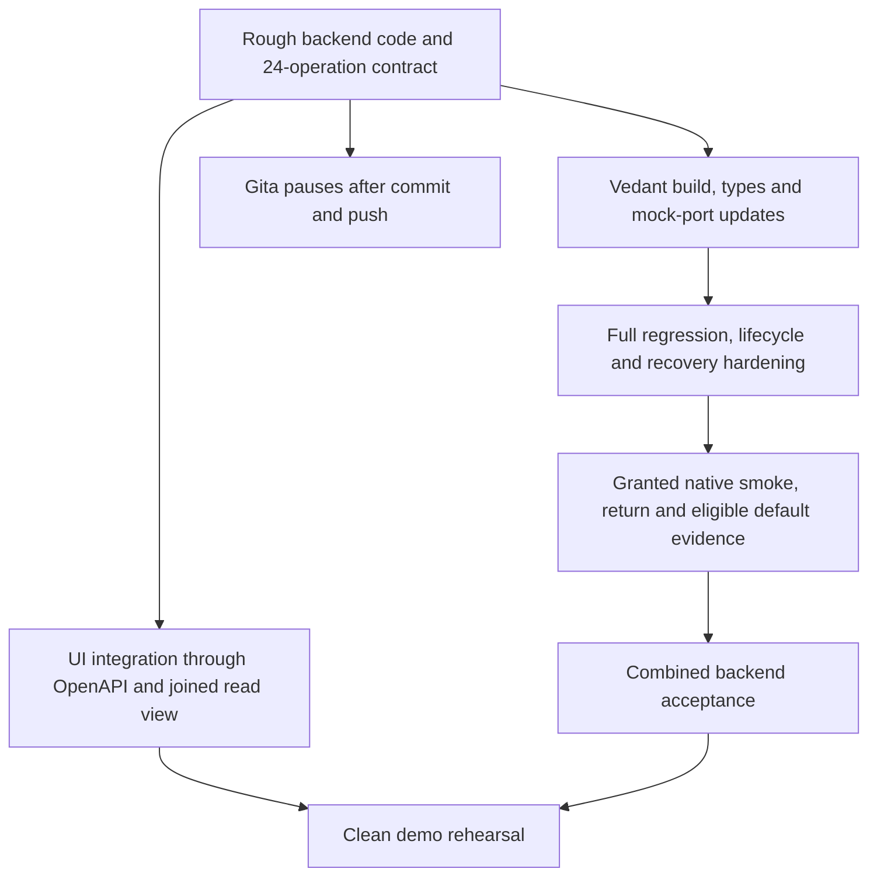

# Shellfish work board

- Revision: setup-r1 adopted. Coordinator: **Vedant** (B-0001 accepted; **B-0002** REVIEW).
- Current objective: [B-0002](CURRENT-BATON.md). Rough backend handoff to Vedant for testing, hardening and UI. Gita pauses after the requested commit/push.
- Accepted claim channel: **GitHub PR comments** on `vedantd/shellfish`.
- Clone mode: **separate clones**.
- Gita implemented the rough native backend under direct user authority. Vedant receives it in REVIEW. No new ACK or coordinator transfer is asserted.
- Accepted C0 base: `08397b5449a6f2853e8d5da921ae29034353e4d2`. Rough integration base: `4237c87`. Publication identity is root's reported delivery commit.

## Feature gates

| Gate | Observable outcome | Status and evidence |
| --- | --- | --- |
| C0 | Accepted contracts, scopes, keys/signature format and native/simulation plan | **ACCEPTED** C0-REP-1. Fixture `native_ready` still false (schema) |
| C1 | One evidence bundle gives lender A approve, B decline and a compatible offer | Producer + HTTP PASS. Screens A/B/C wired to APIs (UI Slice 3). LIVE UI path PASS |
| C2 | Authorization reserves once and only then permits a required signature | LIVE UI smoke: ALLOW → stake → LoanSet on Devnet (AUTH-DEVNET-001). Full consumer acceptance still open |
| C3 | Verified execution changes accounting once, timeout retains reservation | Durable paths coded; connected LoanSet smoke PASS. Return/default/restart audit still open |
| C4 | Clean-start demo, three denials, replay/race/timeout checks and honest mode | Happy-path LIVE demo PASS. Denial buttons exist; full C4 rehearsal + six security TODOs remain open |

## Queued work and claims

| Lane | Owner | First bounded outcome | Depends on | Record | State |
| --- | --- | --- | --- | --- | --- |
| Credit and registry | Gita | Rough native backend and source/API integration delivered for review | Base `4237c87`, selected scale-six product asset | [Gita work](work/SETUP-GITA.md) | PAUSED after commit/push, direct user request |
| Authorization and execution | Vedant | UI Slice 3 + LIVE Devnet A→B→C smoke PASS; hardening/return/default remain | Actual delivery commit and selected configuration | [Vedant work](work/SETUP-VEDANT.md) | REVIEW — Gita can resume producer/schema lanes (`native_ready` still false) |
| Policy examples | Nick | Two exact rules and expected results | Final PRD | Non-coding input to Gita | READY |
| Adversarial examples | Shell | Six bounded negative cases | Final PRD and agreed signing route | Non-coding input to both | READY |

Coordinator ACK of setup-r1: 2026-10-25 00:41 UTC. C0 consumer ACK: 2026-10-25 11:07 UTC.
LIVE product-wiring baton update: 2026-10-25 11:47 UTC. AUTH-DEVNET-001: 2026-10-25 11:54 UTC.
No timeout-based takeover exists.

## Dependency graph

## UI can start now

Read the shared contract from `GET /openapi.json` or `services/api/src/openapi.json`. The rough contract has 24 operations and 56 schemas. Eight new native operations still need integrated validation. `docs/API.md` explains units, modes, request identity and the read flow. Devnet is the native integration target. Local HTTP fixtures validate API recovery without submitting ledger transactions.

| Screen or control | Existing backend call | UI rule |
| --- | --- | --- |
| API contract | `GET /openapi.json` | Single served OpenAPI 3.1 document, generated from current shared schemas |
| Joined credit view | `GET /v1/requests/:id` | Persisted lender decision, approved offer, loan, REP state, receipt, native recorded references and safe attempts |
| Principal mandate | `POST /v1/mandates` | Rough native detached signature verification is implemented. Complete API-path acceptance remains open |
| Evidence | `GET /v1/evidence/business:harbor-supply-demo` | Display returned coverage, observation dates and exposure |
| Lender decisions | `POST /v1/lenders/lender-A/evaluate`, then lender-B, with `{subject_id}` | Same evidence yields A approval and B decline |
| Compatible offer | `POST /v1/offers/match` with `{mandate,offers,evidence?}` | Use the firm returned offer without editing its terms |
| REP and facility state | `GET /v1/facilities/facility-A-001/credit-status` | Display actual REP buckets, asset and scale |
| Curve preview | `POST /v1/facilities/facility-A-001/quote` with `{principal_minor,max_stake_u?}` | Quote is informational. It grants no authorization |
| Borrow action | `POST /v1/authorizations`, then `/v1/loans/originate` | Keep request/reservation/proposal identity from the ALLOW receipt |
| Loan and receipt | `GET /v1/loans/:id`, `GET /v1/receipts/:id` | Show pending, denied and simulated state. Native hashes stay null in simulation |
| Mode | `GET /v1/network` | `live_ready` reports handles/configuration, not ledger proof |

Screen B currently hard-codes exposure 3,000. Opening fixture exposure is 1,000.
Read it from the API. Show the actual demo USD asset, not an implied RLUSD identity.
The current UI should use the fixed approved example. Editable commercial terms need
a newly issued firm offer and matching commitments through the existing backend path.

## Rough backend handoff and remaining acceptance

| Surface | Implementation disposition | Remaining owner/check |
| --- | --- | --- |
| Native product selection | Vedant selected 90 days, zero fees, 550 bps and loan MPT scale six in `4237c87` | Verify conversion/configuration against actual assets |
| SQLite native intents, evidence and approved offers | Coded, including signed mandate and stable intent key | Vedant checks source binding, one-hour cache expiry and native startup |
| Signer lanes and durable origination | Coded, individual signer11 and execution7 checks PASS | Update existing mocks, run full crash/timeout/retry and stopped-worker CAS recovery |
| Authenticated verification | Coded, individual verification15 and mandate17 checks PASS | Native metadata/history/pending/unknown-debt and complete restart audit |
| Repayment/default and issuer returns | Workers coded | Lifecycle runtime tests NOT RUN. Local issuer seed and eligible native deadlines required |
| API and OpenAPI | 24 operations / 56 schemas, OpenAPI12 checks PASS | Combined HTTP/runtime and frontend integration |
| Full acceptance | Not complete | Vedant full suite, hardening, native smoke/return/default and C4 rehearsal |

Final workspace build and typecheck PASS after the scale-six correction. Four focused runtime files PASS with 50 tests.
The full new suite is NOT RUN and the old native mocks need durable transport ports.
Expired absent attempts stay RECONCILING. Operator recovery requires the stopped worker
and exact owner/fence. Native default respects the actual 90-day maturity and seven-day
grace. Earlier native fixture captures remain historical proof, not this acceptance.

## Four handoff contracts

| Producer to consumer | Required payload | Consumer acceptance |
| --- | --- | --- |
| Vedant to Gita | Network/mode, asset identity, borrower, broker ID, SDK pin, supported schedule | Offers and registry use identical identifiers |
| Gita to Vedant | Evidence/version, approved firm offer, match, facility, expiry, source commitments | Transaction construction invents no commercial terms |
| Vedant to Gita to Vedant | Verified request and prepared transaction commitment, atomic reservation result | Required signer sees successful reservation bound to that action |
| Vedant to Gita to Vedant | Execution ID, mode, network, final hash, validation/result/ledger/Loan ID, current accounting | Outcome applies once and UI displays that same state |

## Contract decisions for C0

### Decided (adopted with B-0001)

- One reservation point: final authorization **reserves through Gita's registry before ALLOW**.
  Origination **consumes** the existing reservation without reserving again.
- Claim channel: GitHub PR comments. Clone mode: separate.
- Schemas sole writer: Gita; Vedant accepts before freeze.
- **REP-CURVE-v0.2** is the C0 reputation-bond policy (Nick/Gita product math; Vedant
  engineering accept 2026-10-25). Stake = C(E+P)−C(E). Facility + REP reserved before ALLOW.
  Validated REP redemption before controlled LoanSet. No AMM / consensus change.

### Historical producer requirements, implemented for consumer review

- **Asset identity:** use full `AssetRef` `{ currency, issuer }` on mandate, offer,
  evidence `known_exposure`, and registry. Today mandate has object; offer/evidence use
  string `"RLUSD"` — FAIL until unified.
- **Observation period:** add evidence observation dates or history months so Lender B’s
  ≥12-month rule is computable. Today history is counts only — FAIL until fixed.
- **REP fields:** `model_version`, principal REP spend consent, stake proof / redemption ref,
  pending return credits, suspension / forfeit outcome states.
- Exact retry returns the existing result. Changed payload under the same key fails.
  A new request with a consumed authorization nonce fails. One loan per demo mandate.
- Bind firm principal, nominal annual rate, fees and the actual payment schedule.
  Distinguish interest basis points from all-in cost. Do not silently rewrite the offer.
- Separate offer hash, prepared non-signature transaction commitment and final signed
  transaction hash. Complete autofill before final signing authorization.
- Persist signed execution before submission. A timeout remains RECONCILING with
  capacity retained. Only verified outcome permits commit or safe release.
- Atomic reserve, nonce/idempotency handling and the basic race test belong in P0.
  FR-14's P1 label does not override the PRD section 11.4.2 atomic-reserve requirement.
- Literal `sig-demo-*` strings are fixtures, not cryptographic verification evidence.

C0-REP-1 producer package was accepted by Vedant (AUTH-C0-CONSUMER-001) after reproduce.
LIVE product wiring is on PR #5 and binding repairs are on `9fad690`. AUTH-DEVNET-001 is approved. Remaining gates are durable app state, native source/configuration acceptance, execution/return integration, authenticated verification, smoke and C4 checks. C0 remains accepted.

## Proposed 12 hour order

Times are relative to the acknowledged start, not an absolute deadline or proof of completion.

| Window | Gita | Vedant | Gate |
| --- | --- | --- | --- |
| 0 to 45 minutes | Schemas, fixtures, registry/outcome interface | Transaction fields, signer route, API shell | C0 examples accepted by both |
| 45 minutes to 2 hours | Atomic registry skeleton and evidence seed | Small native loan/signing spike | Registry callable, choose execution mode |
| 2 to 4 hours | Evidence, two lenders, match, reserve checks | Mandate/transaction/authorization against fixture | First real module integration |
| 4 to 6 hours | Accounting outcome handler, fix contracts | Reserve, sign, persist, submit and verify | First connected happy path |
| 6 to 8 hours | Replay, race, timeout, duplicate outcome | Reconciliation persistence and thin UI | Core controls checked |
| 8 to 10 hours | Regression and display/accounting checks | Three views, three visible denials | Shell tests, Nick reviews explanations |
| 10 to 11 hours | P0 policy/accounting fixes | P0 execution/integration fixes | Feature freeze and clean start |
| 11 to 12 hours | Fixture reset and final checks | Rehearse and record with all four | Reproducible demo and accurate labels |

Time-box the native spike. A labeled simulation keeps the same authorization and registry
checks. No simulated result counts as a native loan or supplies a fabricated explorer hash.

## Acceptance and deferred work

Required: A approves/B declines on the same evidence, valid request proceeds, amount/rate/
stale evidence deny without signing, replay cannot duplicate execution, two 2,500 requests
against 4,000 headroom yield at most one reservation, timeout retains capacity, verified
success commits once, and UI mode/hash claims match actual evidence.

Deferred: full repayment UX, extra dashboards/lenders, policy language parser, real KYC,
institution APIs, calibrated scores, production custody and secondary debt markets.
Record unfinished gates here at each checkpoint. Deferred is not COMPLETE.

## Historical producer handoff at Gita's request

Recorded 2026-10-25 10:45 UTC. 128 repository tests PASS / six existing TODOs, 37 separate fixtures PASS.
Gita is paused after commit/push of her verified slice. Vedant's exact dependencies and
checks are in SETUP-VEDANT.md. No consumer ACK or full C0-C4 completion is invented.
Native default and fresh native execution of the shared return queue remain NOT RUN.

## Historical delivery evidence

Updated 2026-10-25 08:30 America/New_York (12:30 UTC) at Gita's direct request. Code `9fad690` is pushed and clean. Build/typecheck PASS, 154 repository tests PASS with six existing TODOs, 20 conformance cases PASS, 26 checker/preflight tests PASS and 37 existing native fixture tests PASS. HTTP simulation smoke PASS. No new native execution is claimed. See CURRENT-BATON for exact next actions.

## Current rough delivery evidence

The current central and individual handoffs distinguish code present from accepted behavior.
Gita's lane pauses after authorized commit/push. Vedant receives testing, hardening and UI.
Individual tests: mandate17, execution7, verification15, signer-lanes11 PASS. OpenAPI12 PASS.
Lifecycle runtime, full combined suite and connected native smoke/return/default are NOT RUN.
Final build/typecheck and actual publication identity come from root's closeout report.

Fresh closeout checks after scale-six correction: workspace build PASS, typecheck PASS, four focused runtime files PASS with 50 tests. Native credit source SQLite smoke PASS with generated wallets and an explicit portfolio verifier test double. Stable intent/signature/evaluation returns APPROVE. This check uses no RPC or ledger transaction. Final OpenAPI 12 checks PASS, including public loan_asset_scale six.
