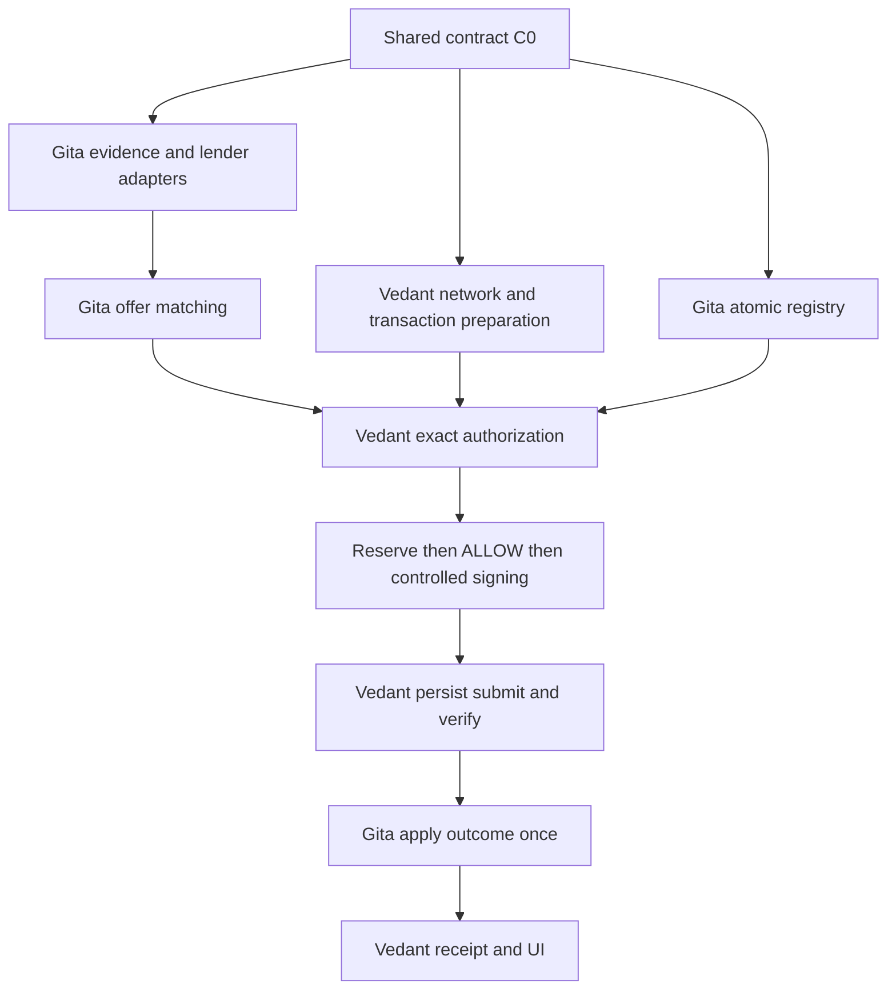

# Shellfish work board

- Revision: setup-r1 adopted. Coordinator: **Vedant** (B-0001).
- Current objective: [shared contract checkpoint B-0001](CURRENT-BATON.md).
- Accepted claim channel: **GitHub PR comments** on `vedantd/shellfish`.
- Clone mode: **separate clones**.
- Gita producer implementation is verified and PAUSED at her request. Vedant integration is READY.
- Updated at Gita's explicit baton handoff request. Coordinator claims and new IDs remain Vedant's.

## Feature gates

| Gate | Observable outcome | Status and evidence |
| --- | --- | --- |
| C0 | Accepted contracts, scopes, keys/signature format and native/simulation plan | REVIEW: producer contracts implemented, Vedant acceptance/native term selection pending |
| C1 | One evidence bundle gives lender A approve, B decline and a compatible offer | Producer implementation and HTTP tests PASS. Consumer acceptance pending |
| C2 | Authorization reserves once and only then permits a required signature | Atomic registry PASS. Vedant authorization and required signer integration pending |
| C3 | Verified execution changes accounting once, timeout retains reservation | Registry accounting/timeout/retry PASS and native fixture happy path recorded. App native integration pending |
| C4 | Clean-start demo, three denials, replay/race/timeout checks and honest mode | Producer checks PASS. Connected UI/denials, six security TODOs and final demo pending |

## Queued work and claims

| Lane | Owner | First bounded outcome | Depends on | Record | State |
| --- | --- | --- | --- | --- | --- |
| Credit and registry | Gita | Shared fixtures, lender/match outputs and reserve/retry proof | C0 examples | [Gita work](work/SETUP-GITA.md) | PAUSED after verified producer delivery, consumer ACK pending |
| Authorization and execution | Vedant | Network/signing spike and gate consuming the agreed reservation interface | C0 examples | [Vedant work](work/SETUP-VEDANT.md) | READY, unclaimed |
| Policy examples | Nick | Two exact rules and expected results | Final PRD | Non-coding input to Gita | READY |
| Adversarial examples | Shell | Six bounded negative cases | Final PRD and agreed signing route | Non-coding input to both | READY |

Coordinator ACK recorded 2026-10-25 00:41 UTC. Profile is the exact path map.
No timeout-based takeover exists.

## Dependency graph

## Four handoff contracts

| Producer to consumer | Required payload | Consumer acceptance |
| --- | --- | --- |
| Vedant to Gita | Network/mode, asset identity, borrower, broker ID, SDK pin, supported schedule | Offers and registry use identical identifiers |
| Gita to Vedant | Evidence/version, approved firm offer, match, facility, expiry, source commitments | Transaction construction invents no commercial terms |
| Vedant to Gita to Vedant | Verified request and prepared transaction commitment, atomic reservation result | Required signer sees successful reservation bound to that action |
| Vedant to Gita to Vedant | Execution ID, mode, network, final hash, validation/result/ledger/Loan ID, current accounting | Outcome applies once and UI displays that same state |

## Contract decisions for C0

### Decided (adopted with B-0001)

- One reservation point: final authorization **reserves through Gita's registry before ALLOW**.
  Origination **consumes** the existing reservation without reserving again.
- Claim channel: GitHub PR comments. Clone mode: separate.
- Schemas sole writer: Gita; Vedant accepts before freeze.
- **REP-CURVE-v0.2** is the C0 reputation-bond policy (Nick/Gita product math; Vedant
  engineering accept 2026-10-25). Stake = C(E+P)−C(E). Facility + REP reserved before ALLOW.
  Validated REP redemption before controlled LoanSet. No AMM / consensus change.

### Historical producer requirements, implemented for consumer review

- **Asset identity:** use full `AssetRef` `{ currency, issuer }` on mandate, offer,
  evidence `known_exposure`, and registry. Today mandate has object; offer/evidence use
  string `"RLUSD"` — FAIL until unified.
- **Observation period:** add evidence observation dates or history months so Lender B’s
  ≥12-month rule is computable. Today history is counts only — FAIL until fixed.
- **REP fields:** `model_version`, principal REP spend consent, stake proof / redemption ref,
  pending return credits, suspension / forfeit outcome states.
- Exact retry returns the existing result. Changed payload under the same key fails.
  A new request with a consumed authorization nonce fails. One loan per demo mandate.
- Bind firm principal, nominal annual rate, fees and the actual payment schedule.
  Distinguish interest basis points from all-in cost. Do not silently rewrite the offer.
- Separate offer hash, prepared non-signature transaction commitment and final signed
  transaction hash. Complete autofill before final signing authorization.
- Persist signed execution before submission. A timeout remains RECONCILING with
  capacity retained. Only verified outcome permits commit or safe release.
- Atomic reserve, nonce/idempotency handling and the basic race test belong in P0.
  FR-14's P1 label does not override the PRD section 11.4.2 atomic-reserve requirement.
- Literal `sig-demo-*` strings are fixtures, not cryptographic verification evidence.

Do not treat open items as accepted code until both engineers ACK the versioned example
in a PR comment.

## Proposed 12 hour order

Times are relative to the acknowledged start, not an absolute deadline or proof of completion.

| Window | Gita | Vedant | Gate |
| --- | --- | --- | --- |
| 0 to 45 minutes | Schemas, fixtures, registry/outcome interface | Transaction fields, signer route, API shell | C0 examples accepted by both |
| 45 minutes to 2 hours | Atomic registry skeleton and evidence seed | Small native loan/signing spike | Registry callable, choose execution mode |
| 2 to 4 hours | Evidence, two lenders, match, reserve checks | Mandate/transaction/authorization against fixture | First real module integration |
| 4 to 6 hours | Accounting outcome handler, fix contracts | Reserve, sign, persist, submit and verify | First connected happy path |
| 6 to 8 hours | Replay, race, timeout, duplicate outcome | Reconciliation persistence and thin UI | Core controls checked |
| 8 to 10 hours | Regression and display/accounting checks | Three views, three visible denials | Shell tests, Nick reviews explanations |
| 10 to 11 hours | P0 policy/accounting fixes | P0 execution/integration fixes | Feature freeze and clean start |
| 11 to 12 hours | Fixture reset and final checks | Rehearse and record with all four | Reproducible demo and accurate labels |

Time-box the native spike. A labeled simulation keeps the same authorization and registry
checks. No simulated result counts as a native loan or supplies a fabricated explorer hash.

## Acceptance and deferred work

Required: A approves/B declines on the same evidence, valid request proceeds, amount/rate/
stale evidence deny without signing, replay cannot duplicate execution, two 2,500 requests
against 4,000 headroom yield at most one reservation, timeout retains capacity, verified
success commits once, and UI mode/hash claims match actual evidence.

Deferred: full repayment UX, extra dashboards/lenders, policy language parser, real KYC,
institution APIs, calibrated scores, production custody and secondary debt markets.
Record unfinished gates here at each checkpoint. Deferred is not COMPLETE.

## Producer handoff at Gita's request

Recorded 2026-10-25 10:45 UTC. 128 repository tests PASS / six existing TODOs, 37 separate fixtures PASS.
Gita is paused after commit/push of her verified slice. Vedant's exact dependencies and
checks are in SETUP-VEDANT.md. No consumer ACK or full C0-C4 completion is invented.
Native default and fresh native execution of the shared return queue remain NOT RUN.
