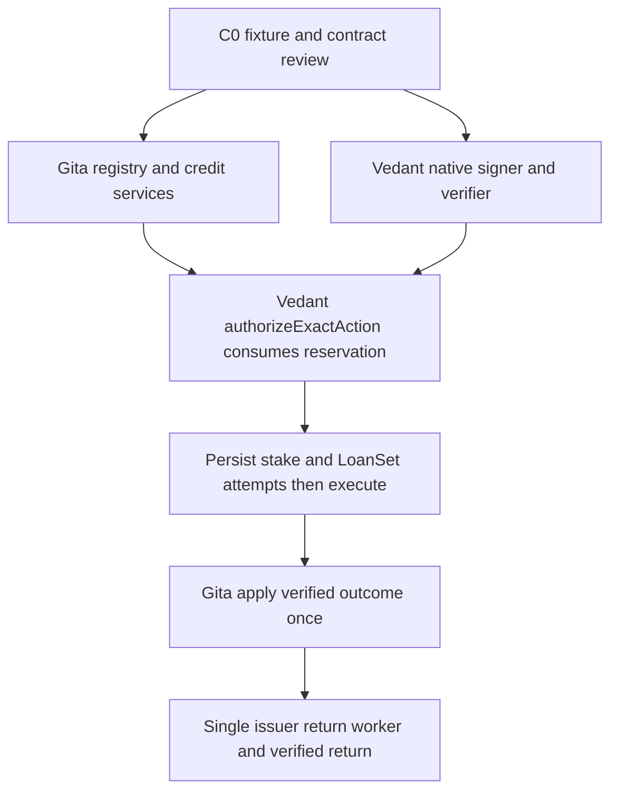
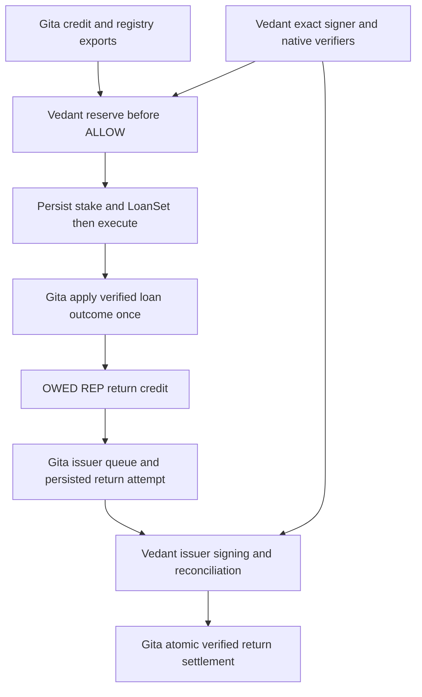

# Gita work record

## Current checkpoint: B-0002 consumer binding repair

- State: REVIEW after implementation and verification. Parent: B-0002. No new coordinator ID allocated.
- Gita resumed work at her direct request on 2026-10-25. She then instructed: "so just do that in the main codebase" for the demonstrated binding defects.
- This direct grant covers the eight tested consumer repair files. It does not transfer coordinator ownership or the remaining authorization/XRPL/UI roadmap.
- Accepted producer base: `08397b5`, C0-REP-1 / REP-CURVE-v0.2, acknowledged by Vedant.
- Repair source base: `3c5f9bc`. PR #6 / `8b6b544` adds Vedant's bounded Devnet execution grant without application source changes.
- Before repair: the connected-source fixture passed 8 cases and failed 12. The failed cases accepted reservation/mandate mismatches or altered origination terms.
- Fixed: bind reservation to mandate/nonce/agent/offer/principal/REP consent and canonical commitments before reserve. Read approved commercial terms from trusted application state and validate them before REP redemption or LoanSet signing.
- Fixed: exact simulated origination retry returns the existing loan without new accounting. Native principal precision rejects before burn. LIVE material construction uses C0 canonical commitments and rejects schedule/fee defaults that conflict with the advertised terms.
- Added Gita fixture tools: `fixtures/consumer-acceptance` and `fixtures/native-preflight`. Both use current source and existing dependencies. Neither loads keys, submits transactions or grants native permission.
- Verification target: workspace build/typecheck, full repository suite, 20 real-source conformance cases, 4 checker tests, 22 native preflight tests and 37 existing native fixture tests. Exact final command results are recorded in the delivery manifest outside this repository and in the delivery response.
- Main's six existing security TODOs remain open. No native lifecycle acceptance is claimed.
- Native remaining dependencies: selected coherent schedule/fees and identifiers, authentic mandate/event/portfolio verification, execution fencing and persisted signed attempts, issuer-return runner, completed-outcome reconciliation and native smoke evidence.
- AUTH-DEVNET-001 belongs to Vedant's bounded smoke run. No native transaction was submitted in this repair.
- Delivery identity: the commit containing this record. No dependency version or lockfile change.
- Next exact action: Vedant consumes the repaired request/approved-offer bindings and resolves the named native integration gaps. Gita can run the source conformance fixture and public-only preflight against his next pushed revision.
- Earlier PAUSED and acceptance-pending entries below are historical. They do not override this direct resume or the C0 consumer ACK.

## Historical initial assignment

- Label: SETUP-GITA → claim next sequential ID when starting implementation (after C0).
- State: READY. Owner and human sponsor: Gita.
- Coordinator: **Vedant, acknowledged** (B-0001).
- Prepared: 2026-10-25 00:19 UTC. Updated: 2026-10-25 00:41 UTC. Started: not started.
- Accepted base: `7fbcfc718b5f7d8b9cb63ebd3f1f6eb9787486b8`, local `main`.
- Parent: [B-0001 contract checkpoint](../CURRENT-BATON.md).
- Contract: scaffold + adopted process; first accepted interface version still pending C0.
- This record is a queued assignment, not implementation authorization.

## First bounded outcome

Publish one accepted evidence/offer/match example and a callable atomic registry
interface. Then prove the first credit/registry slice against that contract.
Target the first two to four hours after C0 examples are accepted.

## Scope

Own the Gita paths listed in the [profile](../PROJECT-PROFILE.md#exclusive-file-scopes-after-acknowledged-claims).
That includes **schemas** (sole writer), evidence, compatibility, registry, fixtures, Gita routes,
database schema/init and named tests. Package manifests are Vedant's exception.
Do not edit authorization, XRPL, web, root configuration or central records.

## Input and acceptance

Inputs: Nick's exact lender rules, Vedant's network/asset/account/broker/schedule contract,
and the final PRD. Evidence can be synthetic but must be labeled and attributable.

- [ ] Shared `AssetRef` `{ currency, issuer }` on mandate, offer, and evidence exposure.
- [ ] Observation period or history months so Lender B’s ≥12-month rule is computable.
- [ ] Same evidence produces lender A approval and B decline with precise reasons.
- [ ] Matching selects an approved offer within the principal mandate without inventing terms.
- [ ] Reservation and nonce/idempotency updates are atomic under the accepted contract.
- [ ] Two 2,500 reservations against 4,000 headroom yield at most one success.
- [ ] Exact retry returns existing state. Changed key payload or consumed nonce fails.
- [ ] Vedant reproduces the fixture and consumes registry exports without ad hoc fields.

Use current `reserveFacility` and `settleReservation` stubs as observed starting points,
not accepted final signatures. Authorization will call reserve **before** ALLOW;
origination consumes the reservation.

## Checks and result

Existing checks: `pnpm test -- tests/schemas.fixtures.test.ts`, `pnpm test`,
`pnpm typecheck`. New behavioral tests need real implementation.
Ask Gita (sponsor) before install if dependencies are missing.
Result: NOT AVAILABLE for runtime product checks; lane not started.
No commit/push/deploy authorized by this record alone.

## Handoff and stop

Return accepted schema version, fixture, exports, patch/base identity, checks and
TODO counts, remaining gaps, release state and Vedant's exact consumer action.
Keep unresolved execution reserved. Apply verified outcomes idempotently in the next
acknowledged slice. Full repayment UX remains deferred.

**Next action:** Publish C0 fixture + registry contract (AssetRef + observation period)
and request Vedant’s acceptance in a GitHub PR comment. Stop for consumer acceptance
before expanding into the next slice. Editing this file does not claim work.

## Approved reputation model handoff

- Recorded: 2026-10-25 03:09 UTC.
- Product math: REP-CURVE-v0.2 approved by Nick and Gita, as confirmed by Gita.
- Files: [canonical model](../../../mathematical-model.md),
  [decision](../../decisions/REP-CURVE-v0.2.md),
  [simulation](../../simulations/rep-exposure-curve.html).
- Completed in this request: documentation, simulation export, exact accounting and
  pseudocode handoff. No application implementation.
- Scope source: AUTH-REP-MATH-001. This lane remains READY and unclaimed.
- Gita's next C0 output: curve policy/hash, exact units, principal REP consent, quote
  and atomic reserve contracts, unique stake/outcome references, pending issuer credits,
  base-exposure appreciation, suspension and idempotent return rules.
- Vedant's consumer action: read the incoming B-0001 notice, accept the C0 execution
  mapping, preserve reserve-before-ALLOW, and bind the required signer to validated
  REP redemption before LoanSet. No AMM or consensus implementation is required.
- Contract acceptance, IDs and implementation claims remain pending coordinator action.

## C0-REP-1 fixture revision for consumer review

- Recorded: 2026-10-25 06:42 UTC. Parent: B-0001. Base: `b495e255be10cbe2aab3d6d33128e888d6534d9b`.
- Source: Gita directly requested implementation of the proposed fixture changes.
- Scope: fixture JSON/README, shared schemas/README, fixture checks and this owner record.
- Contract status: **REVIEW**. Gita requested the revision. Vedant consumer ACK remains pending.
- This is C0 contract preparation. It does not claim either product implementation lane.
- Opening exposure changed to 1000, backed by one original 240 REP bond. Free REP is 760.
- New 2000 loan reserves 720 REP and leaves 40. Old 3000 exposure is a separate denial vector.
- Shared asset reference supports currency/issuer, XRP and MPT issuance IDs.
- Added explicit consent, policy/request commitments, synthetic stake, pending returns,
  default history/suspension, appreciation caps and isolated race/retry vectors.
- Synthetic identifiers and proofs grant no native signing permission.
- Lender A stays a seeded demo approval. No generalized underwriting thresholds invented.
- Reviewed dependency installation was separately approved by Gita in this session.
- Checks in isolated review copy: fixture suite 33 PASS, full suite 34 PASS / 6 existing TODO,
  workspace build PASS, workspace typecheck PASS. Runtime registry/native acceptance not claimed.
- Native execution POC was independently inspected in this session: successful LoanSet
  `7FD5B99815BBED7C2CE56D3049CC0A9D90BB00E0FC062F2A7E7608533730BBEF`, then successful LoanPay
  `5FD957CC15A425EC77FB11CC91984FE67064CF3C2FA4308327970BD85AB4A64F` two seconds later.
  Its MPT asset and 1000/30-day/high-fee terms remain separate from the synthetic 2000/90-day/zero-fee fixture.
- Remaining C0: Vedant accepts mode/asset/signer/schedule/SDK and commitment contracts,
  both ACK the exact patch/revision, coordinator names lane claims and the hour-four check.
- Next consumer action: read `fixtures/README.md` and `fixtures/network-signing-contract.json`,
  reproduce the checks, supply missing native fields or accept simulation for first integration.
- Central baton, profile, board, authorization ledger and other owner's code remain untouched.
- Release: local uncommitted patch. No push, PR comment, database initialization or native submission.

- Final installed-repository checks: workspace build PASS, workspace typecheck PASS,
  full tests 34 PASS / 6 existing TODO, SQLite in-memory module load PASS,
  and git diff whitespace PASS. Locked dependencies are installed in Shellfish.
  Manifests, lockfile and central coordinator records are unchanged.

## Gita registry implementation checkpoint

- State: REVIEW for the local implementation. Parent: B-0001. No new coordinator ID allocated.
- Source: Gita directly requested work on the approved curve and fixture-based application layer.
- Base: b495e255be10cbe2aab3d6d33128e888d6534d9b plus the existing uncommitted C0-REP-1 fixture patch.
- Scope: Gita registry, schemas helpers, evidence, compatibility, Gita routes, API DB helpers and named Gita tests.
- Cross-clone claim/consumer acceptance is still pending. This record does not invent Vedant's ACK.
- Implemented: exact curve/reward math, atomic dual reservations, nonce/key handling,
  persistent loan/accounting outcomes, pending returns, default suspension and liability,
  event-history order checks, execution claims/fencing, immutable signed attempts and prepared-field commitments.
- Implemented: explicit evidence source, seeded A approval/B decline, exact offer matching,
  real HTTP evidence/evaluate/match routes, facility reads and explicit DB/bootstrap helpers.
- Runtime: installed Node 20.14.0. Node 24 crashes locked SQLite cleanup and is guarded.
  Real HTTP tests avoid the incompatible injection helper. No new runtime install was needed.
- Review-copy checks: workspace build PASS, workspace typecheck PASS, 96 tests PASS / 6 existing TODO.
  Includes simultaneous SQLite writers, reopen, partial/full repayment, refunds, default,
  credit binding, history order, executor fencing and actual temporary HTTP requests.
- Native evidence still requires Vedant's trusted verifier callbacks. No native transactions executed.
- Native bootstrap supports a verified empty portfolio. Existing native debt is rejected
  until its opening-history/original-bond contract is supplied. Never hide the exposure.
- Durable issuer-return attempts and issuer sequence serialization remain the next persistence slice.
- Release: local implementation, uncommitted. No push, PR comment or user DB initialization.
- Central records, Vedant's authorization/XRPL/entrypoint/UI, manifests and lockfile remain untouched.

### Current dependency graph

### Exact next consumer actions

1. Vedant reviews C0-REP-1 and the exported registry/event interfaces, then records acceptance.
2. Wire `openFixtureCreditBackend` into the owned API entrypoint for the simulation.
   A separate entrypoint proposal diff is prepared in Gita's task workspace. It is not applied.
3. Connect the POC adapter to native portfolio/event verifiers, REP issuance/redemption,
   prepared-field projection and signed-blob validation. Select exact asset, schedule, fees and SDK/runtime pin.
4. Consume the existing reservation in the authorization path. Never reserve again in originate.
5. Run the first integrated denial/timeout/native checks, then update central C0/C1 status.

There is no missing mathematical input for this local slice. The remaining native contracts
and cross-clone integration are Vedant's dependencies. Gita can continue the issuer-return
persistence helper without editing Vedant's source.

### Supported runtime and SDK correction

- Gita flagged Node 20 end-of-life. The official schedule confirms 2026-04-30.
- Gita approved testing Node 24 plus SQLite 12.10.1, then explicitly requested the latest XRPL.js update.
- Selected local pins: Node 24.21.0, better-sqlite3 12.10.1, xrpl 5.3.0 (npm latest stable at check).
- Candidate verification: workspace build/typecheck PASS and 96 tests PASS / 6 existing TODO under Node 24.
- SDK offline checks PASS: REP ImmutableFlags validation/codec and two-party LoanSet signing.
  Temporary keys were kept in memory. No transactions submitted and no keys logged.
- The compatibility update touches .nvmrc, root engines, API/registry dependency pins,
  XRPL package pin and lockfile. This is a local dependency patch under Gita's request.
  Vedant's adapter, signing, entrypoint, UI and central coordination records remain untouched.
- C0 SDK metadata now states 5.3.0. Native account, schedule, signer and verifier acceptance remains open.

- Installed-repository verification at 2026-10-25 08:33 UTC:
  Node 24.21.0 / SQLite 12.10.1 / xrpl 5.3.0 installed. Workspace build and typecheck PASS.
  Full tests 96 PASS / 6 existing TODO. REP issuance validation and LoanSet counterparty
  signing PASS against the installed SDK, offline with temporary keys and zero network calls.
- Runtime/SDK dependency pins are applied locally for review. No commit or push was made.
- A separate untracked fixtures/xrpl-poc-replay directory appeared during this work.
  It is preserved and excluded from this implementation patch and its test-coverage claims.

### REP issuer return persistence checkpoint

- Parent B-0001. Local state REVIEW. No coordinator ID or consumer ACK invented.
- Source: Gita's active fixture-based implementation request. Base b495e255 plus the
  current uncommitted C0/credit implementation and runtime correction.
- Refreshed apply base: f2323cb0c5e8d8470b9e757deca1df3745439555 after Vedant's
  playground merge. All ten patch targets matched their reviewed source hashes.
  The 17 merged playground/configuration paths and newer POC replay edits are preserved.
- Scope: registry source/README, Gita API DB helpers, registry tests and this record.
- Added `createReturnStore` and `openCreditRegistry(...).returns`. The fixture backend
  exposes the same return store for Vedant's simulation entrypoint.
- Durable queue serializes all REP issuances for one mode/network/issuer account.
  Worker release retains unresolved issuance. Restart recovers the same saved blob.
- Signed Payments bind credit, amount, issuance, destination, fee, sequence, expiry,
  memo and finalized projection. No tickets, alternate delivery or delegation in this MVP.
- Native replacements need a trusted validated failure or complete expiry/absence proof.
  Unexpected sequence advancement stops recovery. Maximum three signed attempts per credit.
- Verified return applies balance, credit, attempt and issuer-lane changes atomically.
  Final cleanup is idempotent and cannot clear a newer worker claim.
- Independent source review found two issues, both corrected: sequence interleaving
  after a failed credit, and finally-block cleanup after settlement. Regression checks added.
- Review-copy checks: workspace build/typecheck PASS. Full tests 112 PASS / 6 existing TODO.
  Registry includes 44 passing checks, with 16 added return cases. No native execution claimed.
- Installed XRPL.js 5.3.0 validates, signs and decodes the generated issuer Payment with
  identical fields, atomic MPT amount and credit memo. Hash and persisted
  retry match. The offline check writes no keys or signed blobs and makes no network calls.
- Native proof hooks in tests are explicit mocks. Offline SDK checks and native validation
  are different evidence. Production authenticity remains Vedant's adapter responsibility.
- Preserved fixtures/xrpl-poc-replay and all other owner's application source/configuration.
- Release: local uncommitted work. No new install, key persistence, network transaction,
  commit, push, PR comment or coordinator-record change.

Next consumer action: Vedant imports `returns`, supplies `verifyReturnFailure`, verifies
the signed blob against `prepareReturnPayment` and submits only the saved attempt.
Review the native event binding additions before accepting C0. Current native asset,
account, schedule, signer and cross-clone acceptance dependencies remain open.

- Installed-repository return checkpoint verified at 2026-10-25 08:56 UTC: workspace build and
  typecheck PASS. Full tests 112 PASS / 6 existing TODO. Offline XRPL.js issuer
  Payment validation, signing, decode, hash and saved retry PASS. Zero network calls.

### Completed E2E session incorporation

- Gita directly requested incorporation of the separate E2E session after completion.
  The side chat `Shellfish: verified event contract explained` completed its native
  repayment fixture on 2026-10-25. Source: fixtures/xrpl-poc-replay/RUN-REPORT.md and
  native-result-2026-10-25T08-52-39-891Z-c8c11959.json. No cross-clone ACK inferred.
- Observed Devnet: REP issuance, 240 REP redemption, LoanSet, LoanPay and exact
  240.000008 REP restoration all validated. Principal 1,000, actual debit 1,015,
  submitted maximum 2,000, 11 seconds of exposure and 8 micro-REP growth.
- Native default remains NOT RUN. Simulation checks prove forfeiture accounting,
  liability retention and suspension. They cannot close native LoanManage acceptance.
- Added registry `projectMptPayment` and captured-data regression checks for API v2
  DeliverMax/Amount, exact REP units, conflicting aliases and LoanPay maxima.
- Corrected return builder network semantics: omit NetworkID for IDs <=1024,
  including Devnet ID 2. Include it for IDs >=1025. The earlier offline codec
  check accepted 1024 structurally. That did not prove the consensus rule.
- Updated the finished standalone harness to consume the durable return queue and
  verify its persisted Payment projection. No new native execution performed.
  The recorded native runs precede this queue migration and remain unchanged.
- Updated native fixture README and registry README. Coordinator-owned architecture
  changes are supplied as a proposal diff in Gita's task workspace, not applied.
- Current dependency: Vedant accepts the exact interfaces and connects his controlled
  signer, authenticated event/failure verifiers, entrypoint and UI. Full native default
  needs its own overdue loan and validated broker action after due date plus grace.

- Installed E2E integration checks at 2026-10-25 09:56 UTC: build/typecheck PASS,
  root tests 116 PASS / 6 existing TODO, separate fixture tests 37 PASS / 0 TODO.
  Native harness syntax and offline SDK return checks PASS. Recorded native
  transactions rechecked read-only at 09:05 UTC. Updated harness native run NOT RUN.

### Credit status and quote API checkpoint

- Scope: shared read schemas, registry source/README, Gita routes, evidence README,
  Gita registry/evidence tests and this owner record. No new dependency or install.
- Added `getCreditStatus(facilityId)` and `quoteCredit(facilityId, input)` using the
  existing approved curve. Status reads the facility and whole portfolio coherently.
- Added GET `/v1/facilities/:id/credit-status` and POST `/v1/facilities/:id/quote`.
  Both require injected registry state and reject execution-mode mismatches.
- Quotes check free REP, facility headroom, optional REP spend cap and suspension.
  Pending returns stay unavailable. Defaulted liability stays visible. All units exact.
- Existing attested passport and lender approval remain unchanged. Live registry
  state is a separate observation, not a fabricated new attestation.
- Meaningful checks cover cross-facility exposure, repricing after concurrent state,
  no mutation, pending returns, default, consent bounds and actual HTTP responses.
- Next Vedant action: inject `openFixtureCreditBackend(...).services` in the API
  entrypoint, then consume the two read routes in the UI. Native mode needs trusted
  services and verifiers. Final authorization must call reserveRequest before ALLOW.

- Installed credit status/quote checkpoint at 2026-10-25 10:09 UTC: build/typecheck PASS,
  root tests 123 PASS / 6 existing TODO, separate fixtures 37 PASS / 0 TODO.
  Checks use real temporary HTTP servers and the installed Node 24 / SQLite 12.10.1.
  No native submission, dependency install, commit, push or coordinator-record edit.

### Backend architecture handoff

- Recorded 2026-10-25 10:21 UTC at Gita's request to formulate the backend from E2E evidence.
- Standalone design: shellfish-backend-architecture.md in Gita's task outputs.
  Coordinator proposal: backend-architecture-proposal.diff in her task workspace.
- Design uses one Fastify API, one SQLite database and a controlled execution path.
  It maps actual exports, request states, native verification and crash recovery.
- Gita owns policy, registry, exact-unit accounting and attempt persistence. Vedant
  owns authorization, required signer, native adapter/verifiers, entrypoint and UI.
- Evidence supports redemption before LoanSet and conditional issuer restoration
  after full repayment. Default forfeits the entitlement, with no second burn.
- Native default, fresh execution of the migrated return queue and the native
  impairment due-date update contract remain open. No proof is inferred from syntax.
- Architecture acceptance and central baton changes remain Vedant's work. His
  architecture file is unchanged. Existing 123/37 test evidence remains current.

### Verified servicing due-date implementation

- Gita continued implementation after the architecture review identified this native
  servicing boundary. Scope: registry types/source/README, registry tests and this record.
- Native IMPAIRMENT and UNIMPAIRMENT require `servicing.nextPaymentDueAt`, verified by
  Vedant's callback against the actual post-LoanManage Loan entry and ordered history.
- Persist the revised due date. Later default uses that date plus the original grace.
  Unimpairment requires prior impairment. It preserves `ever_impaired`, the original
  fixed bond and appreciation maturity. It cannot restore reward eligibility.
- Tests cover moved/restored due dates, exact grace boundary, reward restriction,
  replay, malformed timestamps, missing native schedule and transaction-type binding.
- Native impairment/default remains NOT RUN. This adds the application contract and
  accounting behavior. Native authenticity stays behind Vedant's verifier hook.

- Installed verified servicing checkpoint at 2026-10-25 10:29 UTC: build/typecheck PASS,
  root tests 127 PASS / 6 existing TODO, separate fixtures 37 PASS / 0 TODO.
  Checks use real temporary HTTP servers and the installed Node 24 / SQLite 12.10.1.
  No native submission, dependency install, commit, push or coordinator-record edit.

## Final producer handoff and pause

- Recorded: 2026-10-25 10:45 UTC. Gita explicitly requested verification, both baton updates, commit,
  push and pause while waiting for Vedant. No further feature work is authorized by this closeout.
- Local producer acceptance: shared asset identity and dated history PASS, A approval/B
  decline PASS, exact matching PASS, atomic dual reservation and nonce/key handling PASS,
  original 2,500-vs-4,000 simultaneous-writer vector PASS, exact retry/conflict PASS.
- Implemented decisions: approved REP-CURVE-v0.2, BigInt units, aggregate active+pending
  exposure, fixed per-loan bond, partial repayment retains bond, default forfeits the
  restoration entitlement and suspends borrowing, appreciation uses base principal-time
  with its caps. Native staking burns REP. Full repayment queues a separate issuer return.
- Durable attempts, fencing, issuer-wide return serialization, unknown-state retention,
  current status/quote routes and verified servicing due-date updates are implemented.
- Runtime pins: Node 24.21.0, SQLite 12.10.1, XRPL.js 5.3.0, pnpm 9.15.0.
- Final checks: workspace build/typecheck PASS, 128 repository tests PASS with six existing
  TODOs, separate fixture tests 37 PASS with zero TODOs. Native verifier unit hooks use
  explicit mocks. The standalone native happy path is separate recorded ledger evidence.
- Not completed: Vedant C0 acceptance, required signer/native adapter/verifiers, API
  entrypoint injection, receipts/UI and connected demo. Native default and a fresh run
  of the migrated return queue remain NOT RUN. Existing native debt bootstrap is rejected
  until a verified opening-history/original-bond contract is agreed.
- Gita retains ownership of her modules and is paused. No ownership transfer or Vedant ACK
  is invented. Resume on his consumer feedback or Gita's instruction.
- Commit/push target: existing origin/main. No deployment or new native execution.
